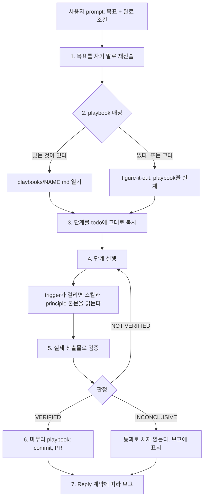

# like-pstack: pstack의 아이디어를 내 스킬 세트에 적용하는 가이드

- 조사 대상: [`harness/pstack/claude-code/`](harness/pstack/claude-code/) (Claude Code용 생성본). 원본은 [`pstack/`](pstack/) (Cursor용)이다.
- 기준: commit `2776ddd`, 2026-11-17.
- 표기: **근거**는 pstack 파일에 있는 사실이다. **제안**은 내가 그 사실에서 끌어낸 적용 방법이다.
- 아래 경로는 따로 표시가 없으면 `harness/pstack/claude-code/` 기준이다.

---

## 0. 30초 요약

pstack은 **라우터 스킬 1개 + playbook 23개 + principle 24개 + 보조 스킬**이다.

동작 순서는 이렇다.

1. 목표를 자기 말로 다시 말한다.
2. 요청에 맞는 playbook을 고른다.
3. playbook 단계를 todo에 **그대로** 복사한다.
4. 단계를 실행한다. 필요한 스킬과 principle은 그때 읽는다.
5. 실제 산출물로 검증한다.
6. 증거를 붙여 보고한다.

내 스킬에 가져갈 것은 다음 8개다.

| # | 가져갈 것 | 한 줄 |
|---|---|---|
| 1 | 입구 하나 | 사람은 목표만 말한다. 절차는 스킬이 가진다. |
| 2 | 색인과 본문 분리 | 라우터에는 한 줄 색인만 둔다. 본문은 매칭된 것만 읽는다. |
| 3 | todo에 그대로 복사 | 건너뛴 단계가 `skip: <이유>`로 남는다. |
| 4 | 조건 → 행동 | 규칙마다 "언제 적용하는가"를 붙인다. |
| 5 | 검증을 구조에 넣기 | 변경 전에 기준을 잡는다. 변경 후 같은 곳에서 다시 본다. |
| 6 | 보고 계약 | 모든 주장에 증거 또는 라벨을 붙인다. |
| 7 | 자율성 계약 | 되돌릴 수 있으면 진행한다. 못 되돌리면 멈춘다. |
| 8 | 교정을 구조로 | 같은 교정이 두 번 나오면 규칙, 스크립트, 검사로 만든다. |

---

## 1. 내 이해가 맞는가

질문의 문장을 조각으로 나누어 확인했다. **뼈대는 맞다. 빠진 조각이 5개 있다.**

| 당신의 이해 | 판정 | 실제 동작 |
|---|---|---|
| 요청이 어떤 종류인지 파악한다 | 맞다 | 그 전에 한 단계가 더 있다. 첫 메시지에서 목표, 문제, 예상되는 최소 변경을 자기 말로 다시 말한다. 확인을 기다리지 않는다. |
| playbook을 선정한다 | 맞다 | 선정 후 단계를 todo에 그대로 복사한다. 맞는 playbook이 없으면 `figure-it-out`이 새 playbook을 설계한다. |
| 지켜야 할 원칙을 가져온다 | 절반만 맞다 | 처음에 전부 가져오지 않는다. 색인(이름 + 적용 시점)만 항상 본다. 본문은 적용할 때 읽는다. |
| 원칙을 기반으로 작업한다 | 맞다 | 보고할 때 "어떤 principle이 어떤 결정을 바꿨는가"를 밝혀야 한다. 읽지 않은 principle은 인용할 수 없다. |
| 검증까지 진행한다 | 맞다 | 검증은 끝에만 있지 않다. 변경 **전**에 repro, baseline, pin을 잡는다. 단위마다 확인한다. |
| 어떤 검증을 거쳤는지 알려준다 | 맞다 | 범위가 더 넓다. playbook마다 `**Reply:**` 줄이 보고 항목을 정한다. 실행하지 못한 검증은 "inconclusive"로 밝힌다. |

빠진 조각 5개:

1. **Non-negotiables.** playbook과 별개로 항상 작동하는 `조건 → 행동` 목록이 있다.
2. **Autonomy.** 언제 묻지 않고 진행하는지, 언제 멈추는지 정해져 있다.
3. **위임.** 주 대화가 playbook을 소유한다. subagent가 한 일도 주 대화가 직접 검토한다.
4. **감사 기록.** 긴 작업은 결정 하나당 한 줄을 TSV에 남긴다.
5. **개선 루프.** 스킬 자체를 고치는 스킬이 있다 (`reflect`, `correct`, `automate-me`, Eval playbook).

---

## 2. 구성 요소 지도

| 요소 | 위치 | 크기 | 역할 |
|---|---|---|---|
| 라우터 | `skills/poteto-mode/SKILL.md` | 152줄 | 입구. trigger, principle 색인, playbook 색인, 자율성, 보고 규칙. |
| playbook | `skills/poteto-mode/playbooks/*.md` | 23개, 대부분 10~25줄 | 작업 유형별 단계 목록. |
| principle | `skills/principle-*/SKILL.md` | 24개, 9~34줄 | 판단 규칙 하나. 적용 시점이 붙어 있다. |
| 워크플로 스킬 | `skills/how`, `why`, `architect`, `arena`, `swarm`, `interrogate` | 각 30~100줄 | playbook 단계가 부르는 하위 절차. |
| 검증 스킬 | `skills/create-verification-skill` 등 | | 프로젝트별 `verify-<app>` 스킬을 생성한다. |
| 기록 스킬 | `skills/show-me-your-work` | 84줄 | 결정 기록(TSV) 형식과 감사 절차. |
| 개선 스킬 | `skills/reflect`, `correct`, `automate-me` | | 세션과 저장소에서 교훈을 뽑아 스킬과 구조를 고친다. |
| 글 스킬 | `skills/unslop`, `technical-writing`, `no-comments` | | 답변, 문서, 주석의 품질 규칙. |
| 위임 agent | `agents/poteto-agent.md` | 9줄 | subagent가 작업 전에 라우터를 읽게 하는 wrapper. |
| 모델 설정 | `~/.claude/rules/pstack-models.md` | | 역할별 모델. 스킬은 역할 이름만 쓴다. |
| harness adapter | `docs/harness/claude-code.md` | 67줄 | Cursor 도구 이름을 Claude Code 이름으로 바꾸는 표. |

**principle 24개의 분류** (근거: 라우터의 Principles 절)

| 그룹 | 개수 | 결정하는 것 |
|---|---|---|
| Core | 10 | 얼마나 만들 것인가. 언제 설계를 다시 볼 것인가. |
| Architecture | 6 | 상태, 검증, 호환성을 어디에 둘 것인가. |
| Verification | 5 | 무엇이 증명인가. |
| Delegation | 2 | 병렬 작업을 어떻게 유지할 것인가. |
| Meta | 1 | 반복되는 지시를 어떻게 구조로 바꿀 것인가. |

---

## 3. 작업 흐름



단계별 근거:

| 단계 | 하는 일 | 근거 |
|---|---|---|
| 1 | 목표, 문제, 최소 변경을 재진술한다. 확인을 기다리지 않는다. 증거가 요청을 부정하면 보여 주고 멈춘다. | 라우터 Non-negotiables 첫 항목 |
| 2 | playbook 색인의 한 줄 설명과 요청을 맞춘다. | 라우터 Playbooks 절 |
| 3 | 단계를 그대로 복사한다. 하지 않는 단계는 `skip: <이유>`로 남긴다. | "Copy its steps in verbatim" |
| 4 | 단계가 스킬을 이름으로 부른다 (`how`, `architect` 등). | 각 playbook |
| 5 | repro한 표면과 같은 표면에서 확인한다. | "Verify on the same surface" |
| 6 | 코드 변경 playbook은 **Opening a PR**로 끝난다. | `playbooks/opening-a-pr.md` |
| 7 | 공통 규칙(Writing the reply) + playbook별 `**Reply:**` 줄. | 라우터, 각 playbook |

**사용자 쪽 규칙도 있다.** prompt에는 5가지만 넣는다. 목표, 완료 조건, 보고 싶은 증거, 이미 아는 것, 실제 제약. 절차와 스킬 목록은 넣지 않는다 (근거: `docs/guide/02-poteto-mode.md`).

---

## 4. 부품 해부

### 4.1 라우터 `SKILL.md`

라우터는 7개 절로 되어 있다. 내 라우터도 이 순서를 쓸 수 있다.

| 절 | 내용 | 형식 |
|---|---|---|
| Non-negotiables | 항상 작동하는 규칙 | `조건 → 스킬 또는 행동` |
| Principles | principle 24개의 색인 | `**이름.** 적용 시점. 한 줄 규칙.` |
| Autonomy | 진행, 멈춤, 세션 override, 반대 의견 | 굵은 머리말 4개 |
| Subagents | 위임 규칙, 모델 선택 | 문단 |
| Writing the reply | 답변 문체, 증거 규칙 | 목록 |
| Comments | 코드 주석 규칙 | 문단 |
| Playbooks | playbook 23개의 색인 | `**이름.** 한 줄 설명 + 예시 문구.` |

색인 한 줄의 예 (근거: 라우터):

```text
- **Bug fix.** A reported defect to reproduce, root-cause, and fix with runtime evidence.
- **Hillclimb.** Sustained, scientific improvement of one metric against a target ... Distinct from Perf issue, which is a one-off fix.
```

배울 점 2개:

- **헷갈리는 이웃을 색인에서 구분한다.** "Distinct from X"를 한 줄 안에 쓴다.
- **사용자가 실제로 쓰는 말을 넣는다.** 예: `("prototype", "mock it up", "try this layout")`.

### 4.2 playbook

`playbooks/bug-fix.md`는 15줄이다. 구조는 4부분이다.

| 부분 | Bug fix의 예 | 목적 |
|---|---|---|
| 소유 문장 | "You own this task. Plan, review, verify." | 책임 범위를 한 문장으로 고정한다. |
| 태도 문단 | "Be scientific. Every shipped line traces to runtime evidence." | 이 유형에서 가장 흔한 실패를 막는다. |
| 번호 단계 | 1 reproduce → 2 binary-search → 3 plan → 4 verify → 5 commit 순서 → 6 PR | 순서 자체가 규율이다. |
| `**Reply:**` | "what was broken, root cause, fix, how you verified. Paste failing-then-passing repro output verbatim." | 보고에 꼭 들어갈 항목. |

**모든 변경 playbook이 "기준 먼저"로 시작한다.** 이것이 가장 중요한 패턴이다.

| playbook | 1번 단계 (변경 전) | 검증 단계 (변경 후) |
|---|---|---|
| Bug fix | 직접 재현한다 | 같은 표면에서 원래 repro가 통과한다 |
| Refactoring | 동작 계약을 테스트나 snapshot으로 고정한다 | 고정한 계약이 그대로 통과한다 |
| Perf issue | baseline trace를 잡는다 | 수정 후 trace를 잡아 비교한다 |
| Visual parity | 스크린샷 baseline을 만든다 | 이미지 diff가 0이다 |
| Hillclimb | 측정 harness를 만들고 고정한다 | 같은 harness로 전후를 잰다 |
| Autonomous run | 종료 조건을 predicate로 쓴다 | 매 반복마다 predicate를 확인한다 |

다른 패턴:

- **경로 재지정.** 범위를 벗어나면 다른 playbook으로 보낸다. 예: Refactoring 중 bug를 찾으면 분리한다.
- **지름길 금지 조항.** 예: Visual parity의 "no harness modifications, no baseline tampering".
- **공통 마무리.** Opening a PR은 다른 playbook의 끝에서 호출된다. commit, PR 형식이 한 곳에만 있다.

### 4.3 principle

principle은 두 곳에 나뉘어 있다.

- **색인** (라우터 안, 항상 본다): 이름 + 적용 시점 + 한 줄 규칙.
- **본문** (별도 파일, 적용할 때 읽는다): 규칙 + `Why` + `Pattern` + 필요하면 `Stop`.

principle이 빈말이 되지 않게 하는 장치 3개:

| 장치 | 근거 |
|---|---|
| 읽은 것만 인용한다 | "Cite only principles whose leaf SKILL.md you read this session." |
| 바꾼 결정을 밝힌다 | "name each principle that shaped a decision and the specific choice it changed." |
| 적용의 흔적이 남는다 | Build the Lever: "Applying this principle produces a file. If you cited it and there is no ... script ... in the diff, you didn't apply it." |

principle 이름은 **사람이 쓰는 조종 단어**이기도 하다. 예: `apply prove it works. show me the real output, not the build log.` (근거: `docs/guide/08-principles.md`)

### 4.4 검증 모델

pstack에서 "검증했다"가 뜻하는 것:

| 규칙 | 뜻 | 근거 |
|---|---|---|
| 완료 조건은 predicate다 | 통과 또는 실패가 나와야 한다. "더 좋게"는 조건이 아니다. | `autonomous-run.md` 1단계 |
| 실제 산출물을 본다 | 실제 명령, 실제 화면, 저장된 실제 값. "it compiles"는 증거가 아니다. | `principle-prove-it-works` |
| 같은 표면에서 본다 | UI bug는 UI에서 확인한다. unit test는 대체물이 아니다. | `bug-fix.md` 4단계 |
| 판정은 3개다 | VERIFIED, NOT VERIFIED, INCONCLUSIVE. INCONCLUSIVE는 통과가 아니다. | `figure-it-out` Phase C |
| 단위마다 확인한다 | 변경 하나, 확인 하나. 끝에 몰아서 하지 않는다. | `principle-sequence-verifiable-units` |
| 검사를 스크립트로 만든다 | 검토자가 다시 실행할 수 있다. "trust me"가 "run this"가 된다. | `principle-build-the-lever` |
| 실패하는 것을 본 검사만 믿는다 | 고장 낸 코드에서 검사가 실패해야 한다. | `docs/guide/06-verify-and-ship.md` |
| 작성자는 판정자가 아니다 | 코드를 쓰지 않은 agent의 판정만 센다. | `shipping.md` 1단계 |
| 숫자는 따로 검증한다 | 무엇이 그 숫자를 제한하는지 말해야 한다. | `benchmark-checklist` |
| 너무 쉽게 통과하면 관측 방법을 의심한다 | 시스템보다 측정을 먼저 의심한다. | `figure-it-out` Phase C |

**검증 스킬은 인프라다.** `create-verification-skill`은 프로젝트마다 `verify-<app>` 스킬을 만든다. 절은 6개다: Launch, Doctor, Drive, Evidence, Cleanup, Helpers. 여기에 feature map(기능별로 "무엇이 보이면 동작한 것인가")이 붙는다. 생성 후 한 번 끝까지 실행해서 증명한다. "A generated skill that was never executed is a draft, not a deliverable."

### 4.5 보고 계약

모든 playbook은 답변으로 끝난다. 규칙은 두 층이다.

**공통 층** (근거: 라우터 "Writing the reply"):

- 목표 재진술로 시작한다.
- 모든 주장에 증거 또는 라벨이 같은 문장에 있다. 라벨은 `measured`, `inferred`, `guess`다.
- 사용자가 받는 영향을 먼저 쓴다. 그 다음 유지보수자가 물려받는 것을 쓴다.
- 만들지도 읽지도 않은 링크와 인용은 쓰지 않는다.
- 내가 실행할 수 있는 확인을 사용자에게 넘기지 않는다.
- 짧게 쓰되 내용은 빼지 않는다.

**playbook 층**: 각 playbook의 `**Reply:**` 줄이 그 유형만의 항목을 정한다.

| playbook | Reply 항목 |
|---|---|
| Bug fix | 무엇이 고장났는가, root cause, 수정, 검증 방법. 실패 → 통과 출력을 그대로 붙인다. |
| Perf issue | baseline 숫자, 수정 후 숫자, 차이, artifact 경로. |
| Refactoring | 바뀐 구조, 고정한 계약, 동등성 증명, 되돌린 것. |
| Autonomous run | 종료 조건, 반복 횟수, 반영한 것, 버린 것, 최종 predicate 상태. |

PR 본문도 같은 생각이다. 절은 `Why`, `What changed`, `Scope`, `Tradeoffs`, `Blast Radius`, `Verification`이다. `Verification`의 각 항목은 "실제 실행 경로와 그 결과"다 (근거: `opening-a-pr.md`).

### 4.6 자율성 계약

| 규칙 | 내용 |
|---|---|
| Just do it | 되돌릴 수 있는 작업은 묻지 않고 진행한다. |
| Always pause | 되돌릴 수 없는 쓰기에서 멈춘다. force-push, deploy, 데이터 삭제, 고객 메시지. |
| Session overrides | "going to bed", "run until done"이면 계속 간다. |
| No is acceptable | 동의가 기본값이 아니다. 근거가 있으면 반대한다. |

**질문 전에 분류한다.** 실행해서 관찰할 수 있는 사실(동작, 시간, 레이아웃, 성능)은 사람에게 묻지 않는다. Prototype playbook으로 확인한다. 사람에게는 제품 방향과 취향만 묻는다.

### 4.7 위임

- **주 대화가 playbook을 소유한다.** subagent에게 playbook 실행을 맡기지 않는다.
- **subagent의 결과도 내 책임이다.** "Review the diff and write your own summary, don't pass through what it said."
- **새 일은 새 subagent에게 준다.** 원래 지시, 이후 지시, 이전 보고를 합쳐서 넘긴다.
- **subagent brief마다 사용자 목표를 다시 쓴다.**
- **스킬에는 역할만 쓴다.** 모델 이름은 설정 파일 한 곳에 있다.

### 4.8 감사 기록

긴 작업, 무인 작업, 나중에 검토할 작업에 쓴다 (근거: `skills/show-me-your-work/SKILL.md`).

- 형식: TSV 한 파일. 결정 하나당 한 줄.
- 열: `ts`, `phase`, `decision`, `why`, `evidence`, `result`.
- `evidence`는 포인터다. commit SHA, `file:line`, artifact 경로. 문단이 아니다.
- append-only다. 틀린 줄은 지우지 않는다. 새 줄로 대체한다.
- 끝날 때 log를 transcript와 대조한다.
- 다른 모델 계열의 subagent가 기록을 검토한다. 답변 끝에 **Attention** 절이 붙는다.

### 4.9 개선 루프

| 스킬 | 입력 | 출력 | 핵심 규칙 |
|---|---|---|---|
| `reflect` | 현재 세션 transcript | 기존 스킬의 수정안 | 검토자 3명 → 종합 → Accepted / Rejected / Backlog. 승인 전에는 적용하지 않는다. |
| `correct` | commit, revert, review 댓글 | 저장소 구조 변경 | 두 번 일어난 실수만 센다. 가장 높은 단계에서 고친다. |
| `automate-me` | 최근 transcript 여러 구간 | `<이름>-mode` 스킬 초안 | 2개 이상의 구간에서 본 패턴만 올린다. |
| Eval playbook | 스킬 변경안 | 채택 여부 권고 | 후보 agent는 평가받는 것을 모른다. |

`correct`의 **강제 단계 사다리** (위가 강하다):

1. 구조로 실수를 불가능하게 만든다.
2. 타입, lint, CI 검사로 막는다. 오류 메시지가 고치는 방법을 말한다.
3. 테스트로 잡는다.
4. 문서나 agent 규칙으로 쓴다. 건너뛰어도 아무것도 실패하지 않으므로 마지막이다.

pstack 자신도 이 규칙을 쓴다. Multi-phase plan의 형식 규칙은 글이 아니라 `scripts/check-plan.mjs`가 검사한다.

---

## 5. 내 스킬 세트 만들기

아래는 **제안**이다. Claude Code 기준이다.

### 5.1 먼저 재료를 모은다

스킬을 쓰기 전에 지난 작업에서 3가지를 뽑는다.

| 찾을 것 | 무엇이 되는가 | 찾는 곳 |
|---|---|---|
| 반복된 작업 유형 | playbook 후보 | 과거 대화의 첫 요청들 |
| 내가 반복해서 한 교정 | principle 또는 trigger 후보 | "아니 그게 아니라", "다시", "왜 X 안 했어" |
| 내가 "됐다"고 한 순간의 증거 | 검증 단계, Reply 항목 | 내가 받아들인 마지막 답변들 |

- transcript 위치: `~/.claude/projects/<slug>/<session>.jsonl` (근거: `docs/harness/claude-code.md`).
- `/pstack:automate-me`가 이 채굴을 대신 한다. 신호 6종을 찾는다: 답변 선호, 위임 습관, 검증 태도, 코드와 글 규율, 절차 관례, 메타 선호.
- 주의: `automate-me`의 결과물은 pstack 위에서 동작하는 mode다. 독립된 세트를 원하면 채굴 결과만 쓰고 구조는 직접 만든다.
- **두 번 규칙.** 한 번 나온 선호는 버린다. 두 번 이상 나온 것만 올린다.

### 5.2 디렉터리 배치

```text
~/.claude/skills/                 # 개인용. 프로젝트용은 <repo>/.claude/skills/
  my-mode/
    SKILL.md                      # 라우터: 색인만
    playbooks/
      investigation.md
      bug-fix.md
      feature.md
      figure-it-out.md            # 맞는 playbook이 없을 때
      wrap-up.md                  # 공통 마무리 (pstack의 opening-a-pr 역할)
    principles/
      prove-it-works.md
      smallest-change.md
    references/
      report-template.md
    scripts/                      # 검사 스크립트 (lever)
<repo>/.claude/skills/
  verify-<app>/SKILL.md           # 프로젝트별 검증 스킬
```

pstack과 다른 점 1개: pstack은 principle을 **독립 스킬**로 둔다. 다른 스킬이 이름으로 참조하기 위해서다. 개인 세트는 `my-mode/principles/` 아래 일반 파일로 시작하는 것을 권장한다. 이유는 2개다.

- 스킬 목록이 principle 24개로 채워지지 않는다.
- `disable-model-invocation: true`인 스킬은 `Skill` 도구로 부를 수 없다. 어차피 경로로 `Read`해야 한다 (근거: adapter의 Tools 표).

다른 스킬이 그 principle을 참조하기 시작하면 그때 독립 스킬로 올린다.

### 5.3 템플릿

템플릿은 영어로 썼다. agent가 읽는 글이기 때문이다. 한국어로 바꿔도 구조는 같다.

**(a) 라우터 `my-mode/SKILL.md`**

```markdown
---
name: my-mode
description: My working style for rigorous, verified work. Use for /my-mode or requests to work in this style.
disable-model-invocation: true
---

# My mode

Playbooks, principles, and references live next to this file. Read a file in full before you apply it.

## Always

- First message on a task → restate the goal, the problem, and the smallest change you expect to meet it. Do not wait for confirmation.
- Before any change → state the done check as a predicate that can pass or fail.
- Before you say "done" → read `principles/prove-it-works.md`.
- <condition> → <action, or file to read>

## Principles

Read `principles/<name>.md` in full before you apply a principle. Cite only principles you read this session. For each one, name the decision it changed.

- **Prove It Works.** After a task, before you say done. Check the real artifact, not a proxy.
- **<Name>.** <When it applies>. <One-line rule>.

## Autonomy

- Proceed without asking: <reversible actions>.
- Always pause: <irreversible actions>.
- Ask the user only for a product or preference call that no run can settle.

## Playbooks

Match the task to one playbook. Open `playbooks/<name>.md`. Copy its steps verbatim into the todo list before any task-specific todos. A step you do not do stays in the list as `skip: <reason>`. If no playbook fits, follow `playbooks/figure-it-out.md`.

- **Investigation.** A read-only question. No code change.
- **Bug fix.** A reported defect to reproduce, root-cause, and fix. Distinct from Feature, which adds behavior.
- **Feature.** New or changed behavior.
- **Wrap-up.** Runs at the end of every playbook that changes files.

## Final report

End every playbook with the report in `references/report-template.md`.
```

**(b) playbook `playbooks/<name>.md`**

```markdown
### <Playbook name>

**You own <one thing>. <Stance in one sentence>.**

<What routes here, and what routes to another playbook.>

1. <Capture the before state: reproduce, record a baseline, or pin the behavior.>
2. <Find the cause or choose the design. Name the principle file if one applies.>
3. <Make the smallest change.>
4. Verify on the same surface as step 1. "Inconclusive" is not a pass. Flag it.
5. Run **Wrap-up**.

**Reply:** <the items that only this playbook must report>.
```

**(c) principle `principles/<name>.md`**

```markdown
# <Principle name>

<The rule, in one or two sentences.>

**Why:** <What it costs to ignore the rule.>

**Pattern:**
- <Concrete move>
- <Concrete move>

**Stop:** <What you must not do until the rule is met.>

**Evidence of use:** <The artifact that exists if you applied this rule.>
```

`Stop`과 `Evidence of use`는 선택이다. `Evidence of use`는 Build the Lever의 "produces a file" 규칙을 일반화한 것이다.

**(d) 최종 보고 `references/report-template.md`**

"어떤 검증을 거쳐서 마무리했는가"를 고정된 표로 만든다. pstack에는 이 표가 없다. pstack의 공통 규칙, `**Reply:**` 줄, PR의 `Verification` 절을 하나로 합친 제안이다.

```markdown
**Goal.** <the restated goal>
**Playbook.** <name>. Skipped steps: <step, reason> or none.

**What changed.** <for the user first, then for the maintainer>

**Verification.**

| Check | How | Verdict | Evidence |
|---|---|---|---|
| <done predicate> | `<command or path>` | VERIFIED | <output excerpt or artifact path> |
| <second check> | `<command or path>` | INCONCLUSIVE | <why it could not run> |

**Principles applied.** <name> → <the decision it changed>.
**Open.** <what is not verified, and what the user must decide>
```

규칙: `Verdict`는 `VERIFIED`, `NOT VERIFIED`, `INCONCLUSIVE` 중 하나다. 증거가 없는 주장에는 `inferred` 또는 `guess` 라벨을 붙인다.

### 5.4 설계 규칙

RFC 2119 키워드를 쓴다.

1. 라우터는 **반드시** 색인만 담아야 한다 (MUST). 단계와 규칙 본문은 별도 파일에 둔다.
2. 색인의 각 항목은 **반드시** 적용 시점을 담아야 한다 (MUST).
3. 파일을 바꾸는 playbook은 **반드시** 변경 단계보다 앞에 "변경 전 상태를 고정하는 단계"를 두어야 한다 (MUST).
4. 각 playbook은 **반드시** `**Reply:**` 줄로 끝나야 한다 (MUST).
5. agent는 **반드시** playbook 단계를 todo에 그대로 복사해야 한다 (MUST). 건너뛴 단계는 `skip: <이유>`로 남긴다.
6. agent는 읽지 않은 principle을 **절대** 인용해서는 안 된다 (MUST NOT).
7. agent는 실행하지 못한 검증을 **절대** 통과로 보고해서는 안 된다 (MUST NOT).
8. agent는 통과시키려고 완료 조건, baseline, 검사 스크립트를 **절대** 바꿔서는 안 된다 (MUST NOT).
9. playbook 하나는 25줄 이하로 유지하는 것을 **권장한다** (SHOULD).
10. 같은 교정이 두 번 나오면 규칙으로 올리는 것을 **권장한다** (SHOULD). 스크립트, lint, 테스트로 강제할 수 있으면 글 대신 그것을 쓴다.
11. 위험이 큰 변경은 작성자가 아닌 agent가 검증하는 것을 **권장한다** (SHOULD).
12. 긴 작업에는 결정 기록(TSV)을 둘 **수 있다** (MAY).

Claude Code 참고: 세션에 todo 도구가 없으면 목록을 답변 안에 두고 단계마다 갱신한다 (근거: adapter의 Tools 표).

### 5.5 키우는 순서

한 번에 다 만들지 않는다. 근거: "Start smaller than you think. ... add a skill or a check when the same failure shows up twice." (`docs/guide/09-make-it-yours.md`)

| 단계 | 만드는 것 | 다음 단계로 가는 조건 |
|---|---|---|
| 1 | 라우터 + 가장 자주 하는 playbook 3개 + wrap-up + 보고 템플릿 | 실제 작업 몇 건에서 보고 표가 채워진다. |
| 2 | 프로젝트별 `verify-<app>` 스킬 | agent가 사람 없이 앱을 실행하고 증거를 남긴다. |
| 3 | principle. 반복된 교정에서만 뽑는다 | 답변에 "principle → 바꾼 결정"이 나온다. |
| 4 | `figure-it-out` 대체 경로 + 결정 기록 | 자리를 비운 작업을 아침에 감사할 수 있다. |
| 5 | 개선 루프. 세션 후 회고, 변경 전 eval, 규칙을 검사로 옮기기 | 같은 교정을 두 번 하지 않는다. |

1단계의 playbook 3개는 5.1에서 뽑은 유형으로 정한다. pstack의 목록을 그대로 가져오지 않는다.

---

## 6. 흔한 실수

| 실수 | 왜 문제인가 | 대신 할 일 |
|---|---|---|
| 라우터에 본문을 다 넣는다 | 매 턴 컨텍스트를 쓴다. 규칙이 묻힌다. | 색인 한 줄 + 별도 파일. |
| "꼼꼼히 검증하라"고 쓴다 | 확인할 수 없는 지시다. | 단계로 쓴다. "같은 표면에서 원래 repro를 다시 실행한다." |
| 검증을 마지막 단계로만 둔다 | 비교할 기준이 없다. | 변경 전 고정 단계를 1번에 둔다. |
| 한 번의 세션에서 규칙을 만든다 | 그 세션에 과적합한다. | 두 번 규칙. |
| principle을 장식으로 인용한다 | 적용 여부를 알 수 없다. | "바꾼 결정"을 요구한다. |
| 작업 중에 스킬을 고친다 | 변경을 검토하고 평가할 수 없다. | 별도 commit 또는 PR로 고친다. |
| prompt에 스킬 순서를 나열한다 | playbook의 순서를 덮어쓴다. | 목표와 제약만 말한다. |
| 다른 스킬의 내용을 복사한다 | 두 곳이 어긋난다. | 경로로 참조한다. |
| 완료 조건이 "더 좋게", "1시간 동안"이다 | 반복이 확인할 것이 없다. | 통과 또는 실패가 나오는 명령이나 artifact. |
| 검증할 수 없는 루프를 돌린다 | 확인 안 된 작업만 빨리 쌓인다. | 검증 스킬을 먼저 만든다. |

---

## 7. 더 읽을 파일

읽는 순서대로 적었다.

| 순서 | 파일 | 얻는 것 |
|---|---|---|
| 1 | [`skills/poteto-mode/SKILL.md`](harness/pstack/claude-code/skills/poteto-mode/SKILL.md) | 라우터 전체. 152줄. |
| 2 | [`playbooks/bug-fix.md`](harness/pstack/claude-code/skills/poteto-mode/playbooks/bug-fix.md), [`refactoring.md`](harness/pstack/claude-code/skills/poteto-mode/playbooks/refactoring.md) | playbook의 표준 모양. |
| 3 | [`skills/figure-it-out/SKILL.md`](harness/pstack/claude-code/skills/figure-it-out/SKILL.md) | playbook을 설계하는 playbook. |
| 4 | [`principle-prove-it-works`](harness/pstack/claude-code/skills/principle-prove-it-works/SKILL.md), [`principle-build-the-lever`](harness/pstack/claude-code/skills/principle-build-the-lever/SKILL.md) | principle 본문의 모양. |
| 5 | [`skills/show-me-your-work/SKILL.md`](harness/pstack/claude-code/skills/show-me-your-work/SKILL.md) | 결정 기록 형식. |
| 6 | [`skills/create-verification-skill/SKILL.md`](harness/pstack/claude-code/skills/create-verification-skill/SKILL.md) | 검증 스킬의 6개 절. |
| 7 | [`skills/automate-me/SKILL.md`](harness/pstack/claude-code/skills/automate-me/SKILL.md) | 내 mode를 뽑는 절차와 guardrail. |
| 8 | [`skills/correct/SKILL.md`](harness/pstack/claude-code/skills/correct/SKILL.md), [`skills/reflect/SKILL.md`](harness/pstack/claude-code/skills/reflect/SKILL.md) | 개선 루프. |
| 9 | [`playbooks/eval.md`](harness/pstack/claude-code/skills/poteto-mode/playbooks/eval.md) | 스킬 변경을 blind로 시험하는 방법. |
| 10 | [`docs/guide/`](harness/pstack/claude-code/docs/guide/README.md) | 사용자 관점의 설명 10장. 06, 07, 09장이 이 문서와 가장 가깝다. |
| 11 | [`docs/harness/claude-code.md`](harness/pstack/claude-code/docs/harness/claude-code.md) | Cursor 이름과 Claude Code 이름의 대응표. |
